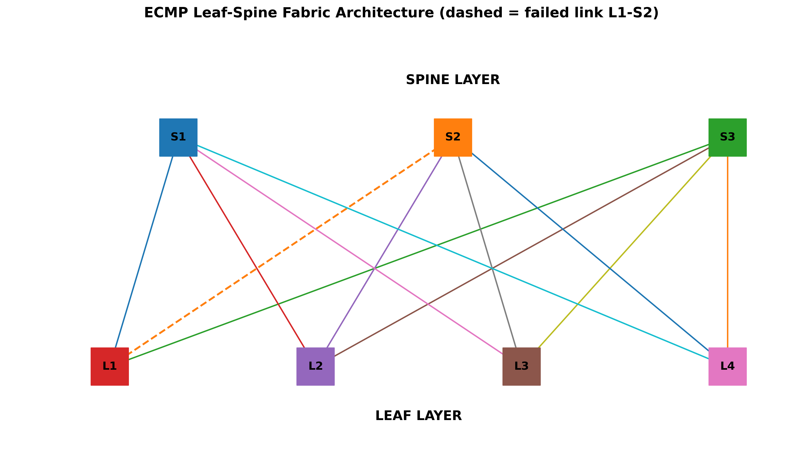
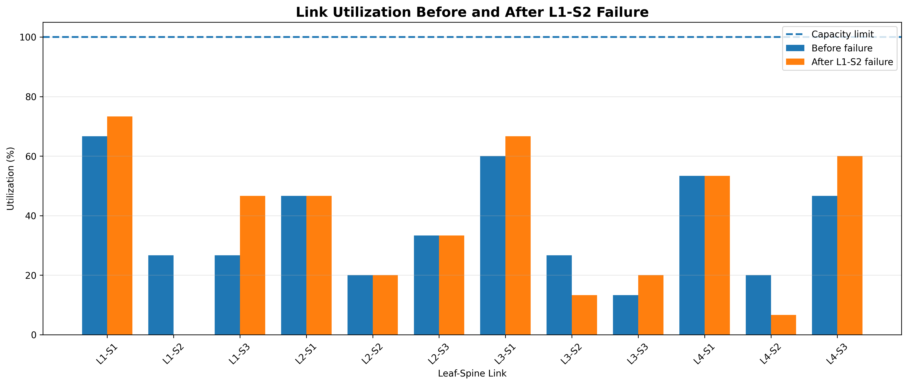
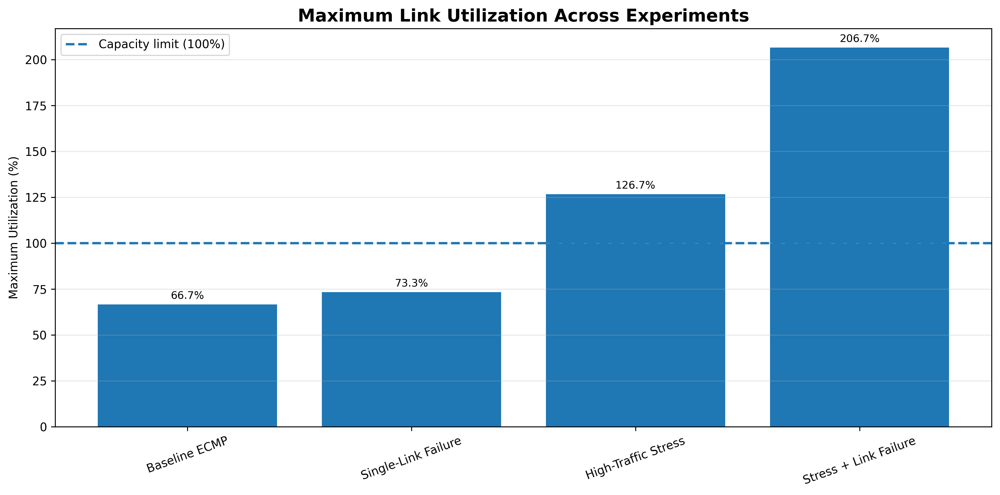

# ECMP Load Distribution and Failure Recovery in a Leaf-Spine Fabric

A Python simulation of **Equal-Cost Multi-Path (ECMP)** routing in a leaf-spine data-centre network. It measures how flows spread across links, finds uneven utilisation, and evaluates traffic recovery after a link fails.



## Network setup
| Parameter | Value |
|---|---|
| Leaf switches | L1, L2, L3, L4 |
| Spine switches | S1, S2, S3 |
| Leaf-spine links | 12 (full mesh) |
| Link capacity | 15 Gbps |
| Flow size | 1 Gbps |
| Equal-cost paths per leaf pair | 3 |
| Failed link | L1 – S2 |

Flows are assigned to paths with `MD5("src-dst-flow") mod (available paths)`. When a link fails, its paths are removed and flows are re-hashed over the survivors.

## Scenarios
1. **Baseline ECMP** – 33 Gbps, no failure
2. **Single-link failure** – baseline traffic, L1–S2 down
3. **High-traffic stress** – 95 Gbps, no failure
4. **Stress + link failure** – 95 Gbps, L1–S2 down

## Results
| Scenario | Max util. | Avg util. | Std dev | Link Jain fairness | Overloaded links |
|---|---|---|---|---|---|
| Baseline ECMP | 66.7% | 36.7% | 16.67 | 0.8288 | 0 |
| Single-link failure | 73.3% | 36.7% | 23.49 | 0.7090 | 0 |
| High-traffic stress | 126.7% | 105.6% | 13.29 | 0.9844 | 6 |
| Stress + link failure | 206.7% | 105.6% | 54.22 | 0.7913 | 6 |

**Failure recovery (L1–S2):** 4.0 Gbps affected, 4.0 Gbps recovered, 0 Gbps without a path, so recovery is **100%**.

### Key findings
- ECMP is uneven even at low load: baseline utilisation ranged from 13.3% to 66.7%. The 12 L1→L4 flows split 6/2/4 instead of 4/4/4.
- A single failure was fully recovered, but balance got worse (Jain 0.8288 to 0.7090).
- Under stress, the same failure pushed one link to 206.7% of capacity.
- Stress had the highest fairness (0.9844) because almost every link was overloaded, so fairness must be read together with maximum utilisation.




## Run it
```bash
git clone https://github.com/<your-username>/ecmp-leaf-spine-simulation.git
cd ecmp-leaf-spine-simulation
pip install -r requirements.txt
python src/ecmp_simulation.py
```
Figures are saved to `results/figures/` and CSV files to `results/data/`. The simulation is deterministic, so results are identical on every run.

## Project structure
```
src/ecmp_simulation.py      simulation, metrics, plots
results/figures/            7 PNG graphs
results/data/               summary and per-link CSV files
```

## Limitations
- Simulation only; no real switches or emulator.
- Equal 15 Gbps links and fixed 1 Gbps flows.
- Static traffic and a single link failure.
- MD5 hashing instead of a hardware switch hash.
- No packet-level effects (loss, queueing, TCP, reconvergence time).

## Team
| Member | Contribution |
|---|---|
| [Name] | [Role] |
